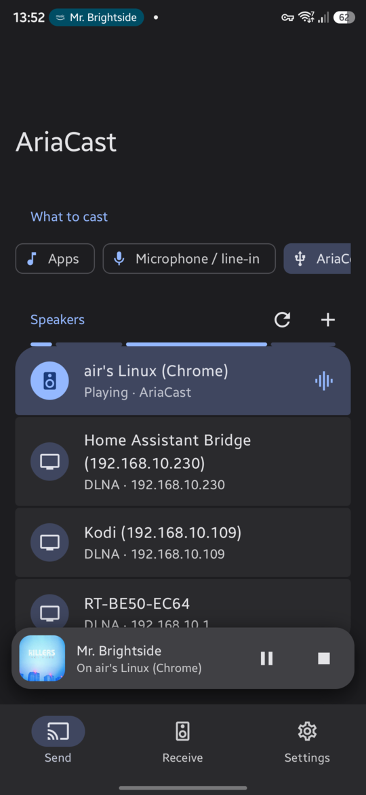
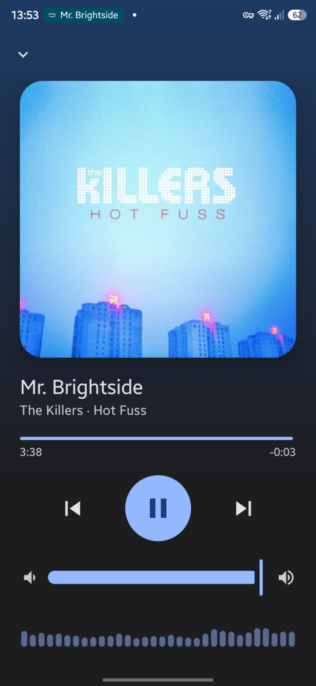
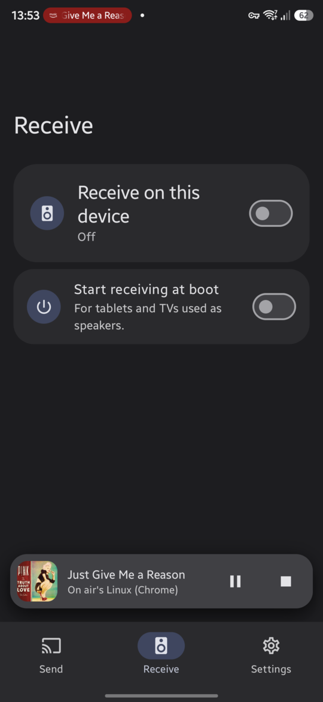
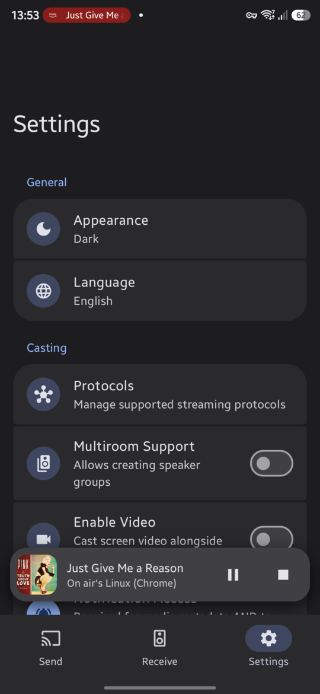
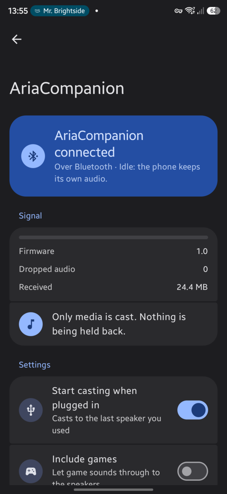
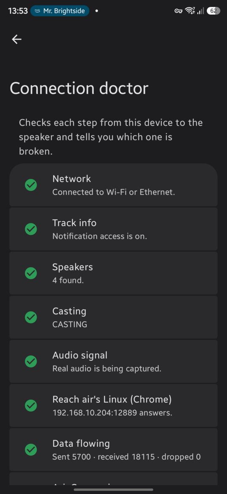

<div align="center">

  <h1>AriaCast for Android</h1>
  <p><b><i>Stream any audio from your Android device to any speaker in your home, or turn it into one.</i></b></p>

  <p>
    <a href="https://github.com/AirPlr/AriaCast-app/releases"></a>
    &nbsp;
    <a href="https://store.colourswift.com/app/com.aria.ariacast"></a>
  </p>

  
  
  
  
  
  

</div>

---

## Overview

**AriaCast** is the bridge between your Android device and your home audio. It captures what your phone plays and sends it to networked speakers, whatever protocol they speak. It also works the other way round: a phone, tablet or Android TV can **receive**, becoming a speaker for AriaCast, DLNA apps and Music Assistant, or a bridge that forwards what it receives to other speakers.

The app has three places, one tap apart:

- **Send**: pick what to cast (other apps, the microphone or a USB line-in, AriaCompanion, or audio this device is receiving), then tap a speaker. A mini-player stays at the bottom while you cast; tap it for **Now Playing**.
- **Receive**: make this device a speaker, name it, play locally or forward what it receives, and open the full-screen receiver for tablets and TVs.
- **Settings**: appearance and language, protocols, multiroom, AriaCompanion, video casting, web remote, NFC tags, automation, plugins and diagnostics.

Colors follow your wallpaper (Material You) on Android 12 and newer. Phones get a bottom navigation bar; tablets and TVs get a navigation rail.

## Supported protocols

| Protocol | Send to | Receive as | Notes |
|---|:---:|:---:|---|
| **AriaCast** | ✓ | ✓ | Native protocol: binary WebSockets, low latency, metadata and artwork sync. |
| **AirPlay 1** | ✓ | | AirPort Express, Apple TV and RAOP receivers. ALAC or PCM, RSA/AES encryption, passwords and on-screen-code pairing, metadata, artwork, progress, remote control and volume sync. |
| **AirPlay 2** | ✓ | | HomePods, Apple TVs, Macs. HomeKit pairing (transient or PIN), encrypted control and audio, metadata, artwork and volume sync; falls back to AirPlay 1 for receivers that need timing Android can't provide. |
| **Google Cast** | ✓ | | Chromecast, Nest speakers and displays, Cast groups. Metadata, two-way volume and play/pause. Optional custom receiver page with artwork on TVs. |
| **DLNA / UPnP** | ✓ | ✓ | Smart TVs, AV receivers, media boxes. As a renderer, any DLNA app can play music or video here; video plays full screen. |
| **Snapcast** | ✓ | | Synchronized multiroom playback through a Snapcast server. |
| **Sendspin** (Music Assistant) | ✓ | ✓ | This device's audio as a Music Assistant Live Input, or a player in sync with Music Assistant's other speakers. Encrypted, paired with a token or QR code. |

## Features

- **System-wide capture** from any app that allows it (see the note on DRM below).
- **Automatic discovery** of AriaCast, AirPlay, Google Cast, DLNA and Snapcast speakers, plus **add by address** for speakers on another network (VPN, VLAN).
- **Groups and multiroom**: save speaker groups, play to several rooms at once, and line rooms up with per-speaker delay.
- **Room handoff**: add, remove or move speakers while casting, without a new screen-capture prompt.
- **Now Playing** with artwork, controls, volume, a visualizer and optional synced lyrics (LRCLIB, off by default).
- **Bridge mode**: forward what this device receives to AirPlay, Cast, DLNA, Snapcast or Sendspin speakers.
- **Full-screen receiver** for tablets and TVs: artwork colors, clock, "scan to cast here" QR code, burn-in protection. Works with the Android TV remote.
- **Video casting** to Google Cast, DLNA and AirPlay, with subtitles and seeking.
- **Known speakers**: a public list of which speakers are supported, supported with quirks or not
  supported, kept in [AriaCast/known-speakers](https://github.com/AriaCast/known-speakers) and
  downloaded by the app once a day (Settings → Known speakers; it can be switched off). The first time
  you cast to a speaker for a minute, AriaCast asks whether it works, and you can **report** it, or look
  for devices it cannot play to, with a pre-filled report on GitHub. A bot records it: a speaker already
  listed has the report counted, a new one is added. Logs stay yours.
- **Connection doctor**: checks the path from this device to the speaker step by step and tells you which step is broken.
- **Web remote**: control AriaCast from any browser on your network through a private link.
- **Quick Settings tiles**, a home-screen **widget**, **NFC tags** that start a cast when tapped, and **automation** intents for Tasker and MacroDroid (opt-in).
- **JavaScript plugins** that draw their own panels (Plugin API v2), see the [plugin documentation](https://github.com/AriaCast/AriaCast-android-plugins).

## Audio from apps that block capture

AriaCast captures audio with Android's `MediaProjection` API. Some apps opt out of capture (for example with `FLAG_SECURE` or DRM), and Samsung blocks capture for some sideloaded apps, so AriaCast can't record them directly. It works well with local players (Poweramp, Musicolet), podcast and audiobook apps (AntennaPod), your own recordings and non-DRM streaming apps.

For everything else there is **AriaCompanion**, a small board that receives the audio as a speaker would and hands it straight back to AriaCast, which casts it anywhere. No root, no screen-capture prompt. Calls stay on the phone, and notification sounds are held back.

| | AriaCompanion (USB) | AriaCompanion BT |
|---|---|---|
| Board | Raspberry Pi Pico or RP2040-Zero | Classic ESP32 (WROOM-32 / WROVER) |
| Connection | USB-C, the phone sees a USB speaker | Bluetooth, the phone sees a Bluetooth speaker |
| Audio back to the app | Lossless 48 kHz / 16-bit over a private USB channel | The phone's SBC frames, forwarded untouched over Bluetooth SPP |
| Firmware updates | From the app | From a computer (ESP-IDF 5.5) |

Build, flash and setup: [AriaCompanion](AriaCompanion/README.md). Design notes: [USB](docs/ariacompanion-2.md), [Bluetooth](docs/ariacompanion-bt.md).

*Advanced users can lift some capture restrictions on rooted devices with the [DisableFlagSecure](https://github.com/LSPosed/DisableFlagSecure) module for LSPosed/Magisk.*

## Setup

1. **Install** the latest [APK from Releases](https://github.com/AirPlr/AriaCast-app/releases) (Android 10 or newer).
2. Follow the first-run guide. It asks for **notification access**: AriaCast needs it to show what's playing, and some receivers (such as the Music Assistant AriaCast Receiver) only start playback when AriaCast signals it through that access.
3. Choose this device's role: send, receive, or both.
4. On **Send**, tap a speaker. That's it.

To use a phone, tablet or TV as a speaker, turn on **Receive on this device** on the Receive screen. On a TV, AriaCast opens straight on the full-screen receiver.

## Building

```sh
./gradlew assembleGithubDebug      # build with the in-app update check
./gradlew assembleFdroidDebug      # F-Droid flavor, no update check
```

The SBC decoder for AriaCompanion BT is native code (BlueZ libsbc), so the build needs the Android NDK (version 27.1, set in `app/build.gradle.kts`).

### Tests

- Unit tests: `./gradlew testGithubDebugUnitTest`
- AriaCompanion USB firmware, host-side: `make -C AriaCompanion/firmware/test`
- AirPlay end to end against real [shairport-sync](https://github.com/mikebrady/shairport-sync) receivers (AirPlay 1, and AirPlay 2 with nqptp): start them with `sudo scripts/e2e/start-receivers.sh` (see the script for options), then run `AIRPLAY_E2E=1 ./gradlew testGithubDebugUnitTest`. The tests check the audio the receiver actually decodes, not just the handshakes.

## Help translate

<a href="https://hosted.weblate.org/engage/ariacast/"></a>

<a href="https://buymeacoffee.com/AirPlr"></a>

## Related projects

- [AriaCast backend server](https://github.com/AirPlr/Ariacast-server)
- [Plugin documentation](https://github.com/AriaCast/AriaCast-android-plugins)

## License

AriaCast is released under the [GNU General Public License v3](LICENSE.md). The bundled SBC decoder is BlueZ libsbc, LGPL-2.1-or-later (`app/src/main/cpp/sbc/`).
